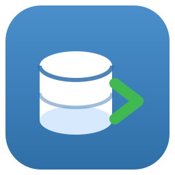
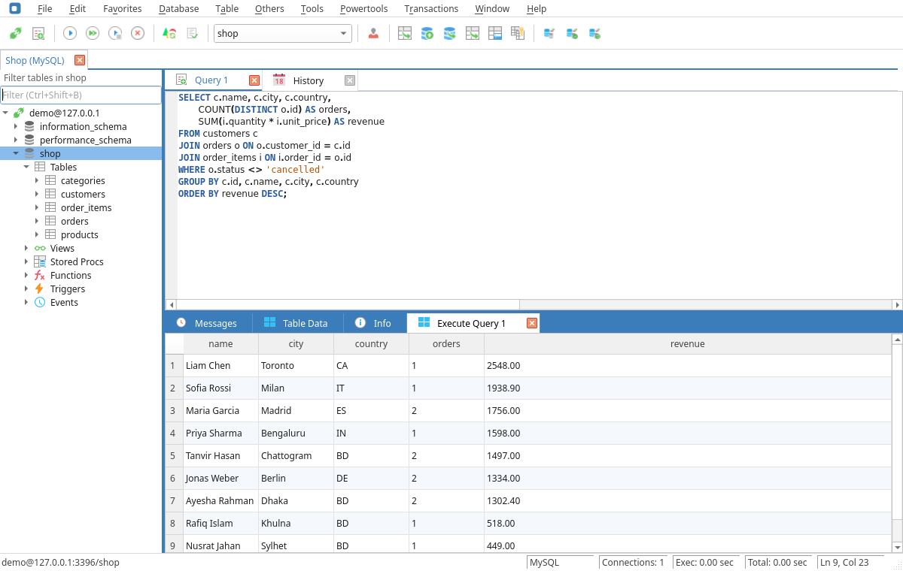
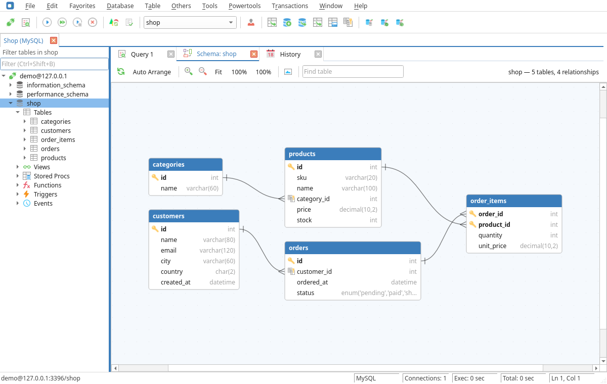
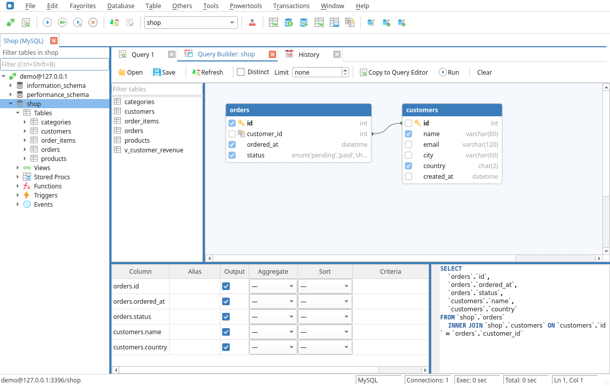
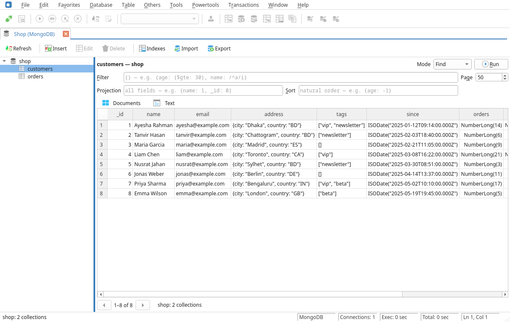
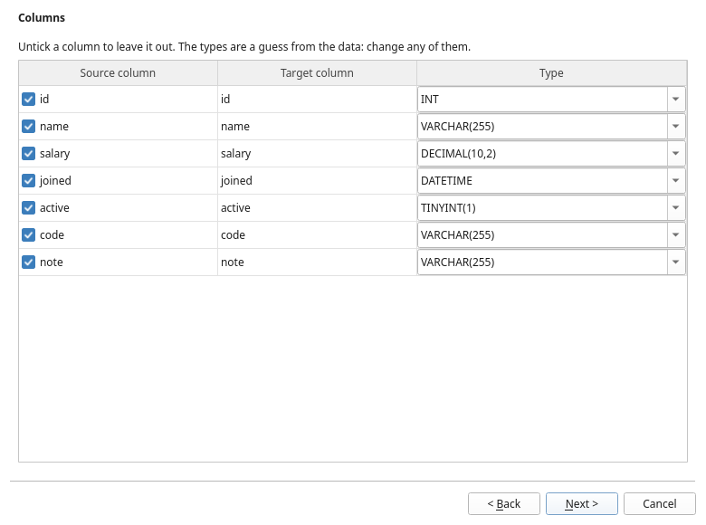

<p align="center">
  
</p>

<h1 align="center">OpenYog</h1>

<p align="center">
  A free, open-source desktop database client for <b>MySQL, MariaDB, PostgreSQL, SQLite and MongoDB</b>,<br>
  on Linux and Windows.
</p>

<p align="center">
  <a href="https://github.com/AbdulOhab/openyog/releases/latest"></a>
  <a href="LICENSE.md"></a>
</p>



OpenYog is a community fork of the SQLyog Community Edition source, with
its Windows-only interface replaced by a Qt 6 one so it runs natively on
Linux and Windows. The menus, toolbars and shortcuts are the ones SQLyog
users already know.

## Features

- **Five databases in one tool**: MySQL/MariaDB, PostgreSQL, SQLite and
  MongoDB, with SSL/TLS and SSH tunnels.
- **Query editor**: syntax highlighting, autocomplete that knows your
  schema, several result grids at once, query history.
- **Table data**: edit, add and delete rows, applied in one transaction.
- **Schema tools**: tables, indexes, foreign keys, views, routines, triggers
  and events; SQL dumps and database copy.
- **Schema Designer**: your database as a diagram; drag a column onto
  another table to create a foreign key.
- **Query Builder**: build a SELECT visually, with joins, aggregates and
  AND/OR conditions; save and reopen it.
- **Schema Sync and Data Sync**: compare two databases and get the script
  that makes one match the other.
- **Import External Data**: from CSV, Excel (.xlsx) or another connection,
  with column types detected from the data.
- **MongoDB**: browse collections, query with filters, sort and projection,
  run aggregation pipelines, and edit documents without losing their types.
- **Your passwords stay private**: saved in the system keychain.

## Screenshots

| Schema Designer | Query Builder |
|:---:|:---:|
|  |  |
| **MongoDB** | **Import External Data** |
|  |  |

## Download

Get the latest version from the
[releases page](https://github.com/AbdulOhab/openyog/releases/latest):

- **Windows 10/11**: the installer (`setup.exe`), or the portable `.zip`.
- **Linux**: the AppImage runs on any distribution. There are also `.deb`
  (Ubuntu, Debian, Mint), `.rpm` (Fedora, openSUSE) and Arch packages.

The AppImage, .deb and .rpm come with their own Qt and libraries. All they
need is glibc 2.35 or newer (Ubuntu 22.04, Debian 12, Fedora 36 and later).

## Build from source

```bash
# Arch
sudo pacman -S --needed base-devel cmake ninja qt6-base qt6-tools qt6-svg \
    qscintilla-qt6 qtkeychain-qt6 libssh mongo-c-driver mariadb-libs postgresql-libs sqlite
cmake -S . -B build -G Ninja && cmake --build build
./build/openyog
```

See [docs/BUILDING.md](docs/BUILDING.md) for the other dependencies, the
tests, packaging and the Windows build.

## Status

OpenYog is young: version 0.1 is usable day to day, but expect rough edges.
The Windows build has so far been tested under wine rather than on real
Windows machines. The HTTP tunnel, scheduled backups and scheduled jobs are
not there yet. Bug reports and ideas are welcome in
[issues](https://github.com/AbdulOhab/openyog/issues).

## License

OpenYog is licensed under the [GPL-3.0-or-later](LICENSE.md). It builds on
the SQLyog Community Edition source that Webyog released under the GPL; the
upstream copyright notices are kept, and the proprietary `htmlayout`
component of the original is not included.

OpenYog is an independent project, not affiliated with or endorsed by
Webyog or Idera, Inc. "SQLyog" is a trademark of its owner.
